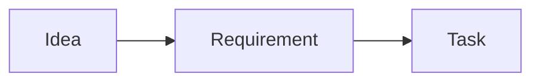

# Markdown preview check

This document is for checking the Weaver Markdown preview. The list, table, and ordinary code fence should stay readable.

- First item
- Second item

| Input | Result |
| --- | --- |
| Mermaid | Diagram |
| JavaScript | Code |

## Valid diagram



## Invalid diagram

The source should stay visible with an explanation.

```mermaid
this is not valid Mermaid syntax
```

## Ordinary code

```javascript
const idea = 'Weaver';
```
